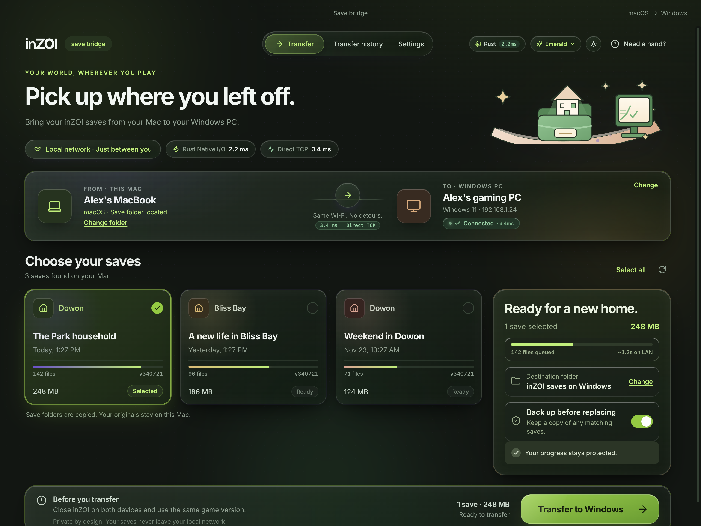

# inZOI Save Bridge

Bring your inZOI saves from a Mac to a Windows PC over your local network — no cloud, no accounts, no USB stick. The app auto-detects both the Mac App Store and Steam save folders, lets you pick the worlds you want, and copies them to the other PC with an optional backup of anything it replaces.



> An independent community tool. Not affiliated with or endorsed by KRAFTON.

---

## What it does

- Detects the correct inZOI save folder on macOS and Windows, including the sandboxed Mac App Store container.
- Scans every save folder and reads its real inZOI metadata (character, world, saved time, size).
- Multi-select saves with instant size totals.
- Finds the other PC automatically over the local network, or connects directly by IP.
- Streams saves with live progress. Both devices confirm before anything is written.
- Optionally backs up any matching save on the destination before replacing it.
- Keeps a local transfer history and exposes every setting in-app.
- Light and dark themes, keyboard-friendly controls, and a native-feeling custom title bar.

## Tech stack

| Layer | Choice |
| --- | --- |
| Shell | Electron 44 with context isolation and a sandboxed preload |
| UI | React 19 + TypeScript, custom CSS design system |
| Build | electron-vite 5 + Vite 7 |
| Icons / type | lucide-react, Inter Variable (bundled) |
| Networking | Node UDP broadcast discovery + streaming HTTP transfer server |
| Packaging | electron-builder (DMG/ZIP for macOS, NSIS for Windows) |

No native modules, no database, no cloud service.

---

## Save paths

| Platform / version | Save folder |
| --- | --- |
| macOS — Mac App Store | `~/Library/Containers/com.krafton.inzoi/Data/Documents/inZOI/SaveGames` |
| macOS — Steam | `~/Documents/inZOI/SaveGames` |
| Windows | `%USERPROFILE%\Documents\inZOI\SaveGames` (also checks OneDrive Documents) |

If both Mac versions are installed, Save Bridge inspects both and defaults to the one with the most recently modified saves. Use **Change folder** to switch or browse to a custom location.

---

## Requirements

- Node.js 20+ and npm (for development)
- macOS 12+ or Windows 10/11 for the desktop apps
- Both devices on the same local network (same Wi-Fi/Ethernet)
- The same inZOI game version on both devices

## Development

```bash
npm install
npm run dev
```

`npm run dev` launches the Electron app with Vite hot reload. The app's own HTTP receiver and discovery service start automatically.

To preview the interface with three sample saves and a sample destination (no files are touched):

```bash
INZOI_DEMO=1 npm run dev
# Windows PowerShell: $env:INZOI_DEMO="1"; npm run dev
```

Useful scripts:

```bash
npm run typecheck      # TypeScript, no emit
npm run test           # typecheck + transfer/scan smoke tests
npm run test:transfer  # isolated end-to-end transfer test
npm run build          # production bundles in out/
npm run package:mac    # DMG + ZIP in release/
npm run package:win    # NSIS installer in release/
npm run icons          # regenerate build/icon.icns, .ico, .png from build/icon.svg
```

### Visual QA helpers

The main process supports a few environment variables used while reviewing the UI. They are development-only and have no effect on normal use:

```bash
INZOI_CAPTURE=/tmp/shot.png INZOI_CAPTURE_WIDTH=1900 INZOI_CAPTURE_HEIGHT=1280 npm run dev
INZOI_CAPTURE_THEME=dark INZOI_CAPTURE_PAGE=settings npm run dev
```

---

## macOS permissions

### Full Disk Access (Mac App Store version)

macOS protects another app's container. To read the App Store save folder, the signed app needs Full Disk Access:

1. Open **System Settings → Privacy & Security → Full Disk Access**.
2. Click **+** and add **inZOI Save Bridge** from `/Applications`.
3. Make sure the switch is on, then quit and reopen Save Bridge.
4. Return to the app and press **Try again** / refresh.

When running from source, the permission attaches to the Electron development binary, not the final app. Use the packaged `.app` for permission testing.

If you prefer not to grant Full Disk Access, use **Change folder** and point Save Bridge directly at the SaveGames folder with the macOS file picker. The picker grants access to that folder for the running app.

The in-app **Need a hand?** sheet and the source-folder sheet both contain an **Open Full Disk Access** shortcut. If the folder still shows as blocked, quit the app completely (⌘Q) and relaunch after granting access.

### Local Network

- macOS 15+ asks for **Local Network** access the first time Save Bridge starts its receiver. Allow it in **System Settings → Privacy & Security → Local Network**.
- If the macOS firewall asks whether to allow incoming connections, choose **Allow**.
- On Windows, allow Save Bridge on **Private networks** in the Windows Defender Firewall prompt.

If discovery is blocked, use **Change → Connect by IP** with the destination's local IP and port. The default transfer port is **47772**; discovery uses UDP **47771**.

---

## How a transfer works

1. **Scan.** The sender reads `SaveGames` (using the App Store or Steam path) and parses each save's `IZTB` metadata block for character, world, game version, and saved time.
2. **Discover.** Every running app broadcasts a small presence packet over UDP on the local network every 2.5 seconds. It contains the device name, platform, receiver port, and save-folder path — never file contents.
3. **Prepare.** The sender walks the selected save folders, builds a manifest (relative path + size + total), and POSTs it to the destination.
4. **Confirm.** By default the destination shows an in-app confirmation with the sender, saves, total size, and destination folder. The user can accept or decline. This can be disabled in **Settings → Ask before accepting transfers**.
5. **Stream.** Files are uploaded sequentially over HTTP to a hidden temp folder *inside* the destination SaveGames folder. Progress is streamed back to both apps.
6. **Install.** Once every file has arrived, each save folder is swapped into place. If a save with the same folder name already exists:
   - **Back up before replacing ON** (default): the existing folder is moved to `.inzoi-save-bridge-backups/<timestamp>/<save>` before the new one is installed.
   - **OFF**: the existing folder is replaced. The new save is only swapped in after the complete upload has been verified.
7. **Record.** Both apps add a local receipt to **Transfer history**.

The sender never deletes or modifies anything on the source device. File paths are validated server-side (no absolute paths, `..`, or traversal), transfer sizes are checked against the manifest, and only files declared in the manifest can be written.

### Network protocol at a glance

| Endpoint | Purpose |
| --- | --- |
| UDP `47771` | Presence broadcast / discovery |
| `GET /api/info` | Device handshake for manual IP connections |
| `POST /api/prepare` | Validate manifest, request acceptance |
| `PUT /api/transfer/:id/file?path=…` | Stream one file |
| `POST /api/transfer/:id/complete` | Verify, back up, and install |
| `POST /api/transfer/:id/abort` | Clean up a cancelled transfer |

Transfers stay on the LAN. There is no relay, account, or telemetry. The receiver asks for consent by default; because this is a LAN utility, anyone who can reach the port and has consent can send files. Use it on networks you trust.

---

## Data and backups

- Settings and history: the Electron user-data folder
  - macOS: `~/Library/Application Support/inZOI Save Bridge`
  - Windows: `%APPDATA%\inZOI Save Bridge`
- Destination backups:
  - `…/inZOI/SaveGames/.inzoi-save-bridge-backups/<timestamp>/<save folder>`
- Original saves on the sender are never touched.

To restore a backup, quit inZOI, move the timestamped folder back into `SaveGames`, and restart the game.

---

## Build and distribution

### macOS

```bash
npm run package:mac
```

Produces arm64 and x64 DMGs and ZIPs in `release/`. The app is unsigned by default, so macOS may ask you to right-click → **Open** the first time. For distribution, sign and notarize with an Apple Developer ID:

```bash
export CSC_LINK=/path/to/certificate.p12
export CSC_KEY_PASSWORD=…
export APPLE_ID=…
export APPLE_APP_SPECIFIC_PASSWORD=…
export APPLE_TEAM_ID=…
npm run package:mac
```

The build enables the hardened runtime and includes usage descriptions for Documents and Local Network access.

### Windows

Run on Windows:

```bash
npm run package:win
```

Produces an NSIS installer in `release/`. The installer is unsigned by default, so Windows SmartScreen may ask you to confirm; sign it with a code-signing certificate for public distribution. The included GitHub Actions workflow builds both platforms on native runners.

### CI

`.github/workflows/build.yml` builds macOS and Windows artifacts on every push to `main`, on version tags, or manually. Artifacts are uploaded from `release/`. Add signing secrets to the workflow if you want signed installers.

---

## Tests

```bash
npm run test
```

The smoke test creates an isolated SaveGames tree and verifies:

- save folder discovery and `IZTB` metadata parsing;
- end-to-end local HTTP transfer with progress events;
- replacement of an existing destination save;
- backup creation;
- rejection of path-traversal attempts.

It does not touch your real inZOI saves.

---

## Project layout

```text
src/
  main/
    index.ts         Electron entry, IPC, capture/QA helpers
    controller.ts    App state, peer selection, settings, history wiring
    window.ts        Native window + menu setup
    paths.ts         Platform save-folder detection and permission state
    saves.ts         Save scanning, metadata parsing, file collection
    discovery.ts     UDP presence broadcasts and peer registry
    server.ts        Receiver HTTP server and safe install/backup logic
    sender.ts        Manifest building, streaming upload, progress
    store.ts         Atomic settings/history persistence
    demo.ts          Sample data for design previews
  preload/           Typed contextBridge API
  shared/            Shared types and protocol constants
  renderer/          React UI (Transfer / History / Settings + modals)
scripts/
  transfer-smoke.ts  End-to-end transfer test
  generate-icons.mjs Icon pipeline (macOS)
```

---

## Troubleshooting

**“No PC found yet.”**
Check that Save Bridge is open on both devices, both are on the same network, and the local-network/firewall permission is allowed. Press refresh, then use **Connect by IP** with the address shown on the destination device. Some guest Wi-Fi networks isolate clients from each other.

**The Mac App Store folder says “No access.”**
Grant Full Disk Access, quit the app fully, then reopen. Or choose the folder manually with **Change folder**. Make sure you granted access to the packaged app, not just Terminal/Electron in development.

**The transfer is declined or times out.**
The destination must accept within two minutes (unless “Ask before accepting” is off). If the destination sleeps or the app quits, the sender stops and leaves the source untouched.

**Replacing fails.**
Close inZOI on both devices. Windows can lock files inside an open save. Retry; backups are preserved under `.inzoi-save-bridge-backups` if a swap was interrupted.

**The save does not appear in inZOI.**
Use the same game version on both devices and the same save-folder type the game expects (App Store container vs Steam Documents). You can verify the destination in **Settings → Receiving into**. Restart inZOI after transferring.

**Port conflict.**
Change **Settings → Transfer port** on both devices (or use the manual IP form). The receiver automatically tries the next few ports if the configured one is busy and advertises the port it actually uses.

---

## Known limitations / roadmap

- v1 focuses on LAN transfer. USB export and cloud sync are not included yet.
- Transfers require both apps to be running; there is no background daemon.
- Large saves are streamed sequentially to keep memory use tiny; multi-gigabyte transfers are fine but one file is sent at a time.
- The app is not sandboxed (intentionally, so it can access SaveGames). Mac App Store distribution is not possible in this form; use the DMG/ZIP build.
- Automatic update checks are not enabled.
